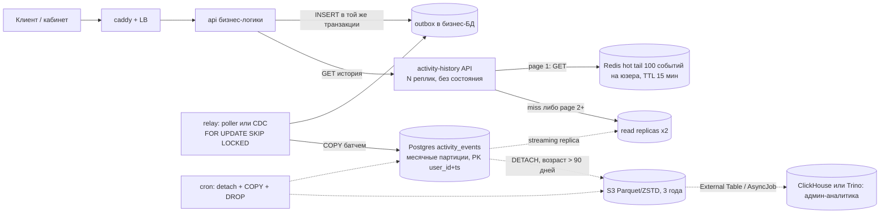
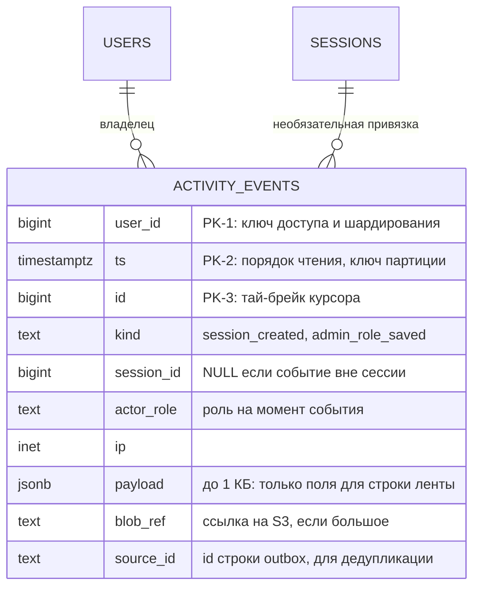
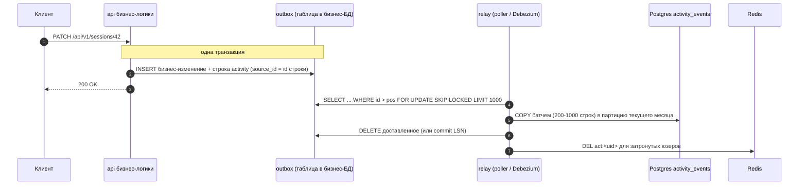
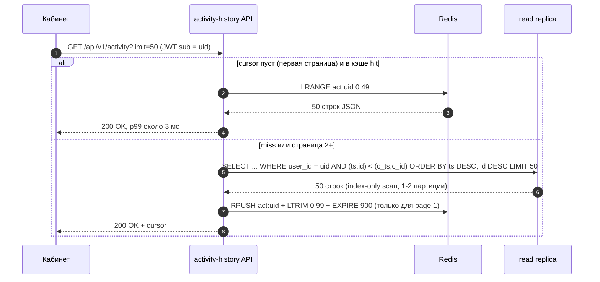
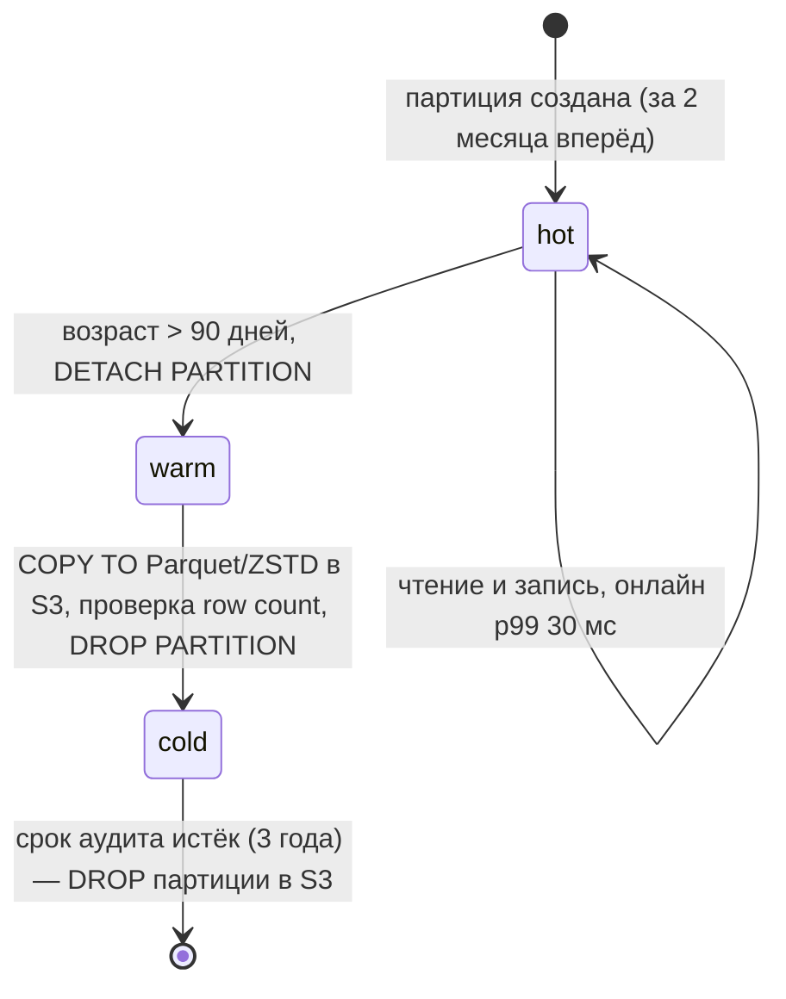

# Сервис истории действий (activity-history)

Проектный дизайн read-heavy сервиса «лента действий пользователя». Цифры в §0 —
допущения, от них зависит весь выбор; под свой трафик пересчитать, §7 говорит, при
каком обороте что менять. Код не менялся — здесь только схема.

## 0. Допущения

| Метрика | Значение |
|---|---|
| DAU | 1 000 000 |
| действий на юзера в сутки | 30 → **30M событий/сутки** |
| запись | ~350/с в среднем, пик ×6 ≈ **2k/с** |
| чтение (×20 к записи) | **600M/сутки** ≈ 7k rps, пик 40k rps |
| форма чтения | 95% — своя история, «свежие сверху», первые 3 страницы за 7–30 дней |
| вес события | ~400 Б (payload ≤ 1 КБ, остальное — ссылка на объект) |
| хранение | hot 90 дней, cold 3 года (аудит) |
| SLO | чтение p99 < 30 мс; события не теряются; read-your-writes для владельца |

Отсюда ёмкость: hot ≈ 30M × 400 Б × 90 сут ≈ **1,1 ТБ** данных + ~30% индексы →
1,5 ТБ NVMe. Cold в Parquet/ZSTD (×8) ≈ **550 ГБ/год**.

## 1. Форма задачи важнее выбора СУБД

Три свойства, которые определяют всё остальное:

1. **Ключ чтения всегда `(user_id, ts DESC)`.** Физическая раскладка = шаблон доступа:
   страница истории одного юзера = один обратный index scan внутри 1–2 партиций.
   Вторичные индексы, полнотекстовый поиск и Elasticsearch под это не нужны.
2. **Это pull-фид, а не лента подписок.** Читают только свои события → fan-out-on-write
   не нужен: нет размножения события на читателей, есть index seek по владельцу.
   Если появится «лента подписок» — это другой проект, схема ниже не годится.
3. **Append-only.** События не обновляются и не удаляются. Отсюда: никаких UPDATE на
   горячем пути, партиции уходят целиком через `DETACH`, «удаление по GDPR» —
   crypto-shred (§9).

Следствие для записи: событий в 20 раз меньше, чем чтений, и терять нельзя ни одного.
Поэтому writes идут **через outbox бизнес-транзакции** (событие живёт или умирает
вместе с изменением), а не «отправили в Kafka и надеемся».

## 2. Схема



| Узел | Роль | Почему он |
|---|---|---|
| `outbox` + `relay` | доставка без потерь | бизнес-транзакция не ждёт чужую БД; событие не теряется, если writer упал. Kafka — только за порогом из §7 |
| `Postgres` partitioned | единственная правда | ключ чтения совпал с PK; ретенция = один `DETACH` |
| `read replicas` | все чтения из БД | writer не конкурирует с читателями за буфер и checkpoints |
| `Redis` | только первая страница | 85% чтений — первая страница, она же дороже всех |
| `S3` + `ClickHouse` | cold и сквозные фильтры | «все `admin_role_saved` за квартал» — OLAP, не OLTP (§11) |

## 3. Модель данных


DDL. Отклонение от конвенции репозитория (в Grade метки времени — `text` RFC3339):
здесь `timestamptz`, иначе не работают partition pruning и BRIN. Обоснование — §12.

```sql
CREATE TABLE activity_events (
  user_id    BIGINT       NOT NULL,
  ts         TIMESTAMPTZ  NOT NULL,
  id         BIGINT       NOT NULL,          -- детерминированный из source_id (hash), не identity
  kind       TEXT         NOT NULL,
  session_id BIGINT,
  actor_role TEXT,
  ip         INET,
  payload    JSONB        NOT NULL DEFAULT '{}',
  blob_ref   TEXT,
  source_id  TEXT,
  -- PK покрывает чтение и тай-брейк курсора; в партиционированной таблице
  -- обязан включать ключ партиции (ts).
  PRIMARY KEY (user_id, ts, id)
) PARTITION BY RANGE (ts);

-- Партиция на месяц, создаётся заранее (pg_partman или cron за 2 месяца вперёд).
CREATE TABLE activity_events_2026_11 PARTITION OF activity_events
  FOR VALUES FROM ('2026-11-01') TO ('2026-12-01');
```

Что сознательно не сделано:

- **Отдельный индекс на `(user_id, ts DESC)` не нужен** — PK уже даёт обратный scan,
  второй индекс только замедлит запись и съест ~30% объёма.
- **`source_id` не `UNIQUE`**: в партиционированной таблице уникальность обязана включать
  `ts`, а дедуп нужен по `source_id` в целом. Дедуп — на приёме (`SETNX dedupe:<id>`,
  TTL 1 час) плюс `INSERT ... ON CONFLICT (user_id, ts, id) DO NOTHING`; `id` выведен из
  `source_id`, так что повтор, проскочивший SETNX, схлопывается сам.
- **payload ≤ 1 КБ.** Логи, диффы, аудио — в объектное хранилище, в строке `blob_ref`.
  Иначе страница из 50 строк весит мегабайты и кэш перестаёт помогать.

## 4. Путь записи



Правила:

- Событие коммитится **вместе** с изменением — нет окна, в котором действие есть, а
  истории нет. Relay может отстать, но не потерять.
- Relay батчит в `COPY`; 2k событий/с уходят пачками по 500–1000, на Postgres это
  единицы запросов в секунду.
- `DELETE`/`commit LSN` после успешной вставки → как минимум один раз; дедуп в §3.
- Мониторинг relay: `max(outbox.id) - relay.pos` (лаги в строках). Лаг > 60 с — alert:
  история отстаёт, read-your-writes держится на §5 (инвалидация кэша на чтении).

## 5. Путь чтения



```sql
-- Курсор вместо OFFSET: OFFSET 5000 на глубокой странице читает и выбрасывает 5000 строк.
SELECT ts, id, kind, session_id, payload, blob_ref
FROM   activity_events
WHERE  user_id = $1
  AND  (ts, id) < ($2, $3)          -- курсор с предыдущей страницы
ORDER  BY ts DESC, id DESC
LIMIT  $4;                          -- 50, потолок 200
```

Политика кэша:

| Что | Как | Почему |
|---|---|---|
| Ключи | `act:<uid>` (list, 100 последних), `dedupe:<source_id>` | одна форма доступа — одна форма ключа |
| Пишет кэш | читатель (cache-aside) | writer'у не нужно угадывать, что увидит читатель |
| Инвалидация | relay делает `DEL act:<uid>` после вставки | `DEL`, а не `LPUSH`: гонка двух writer'ов в списке даёт перепутанный порядок, а `-15%` hit rate — копейки |
| TTL | 900 с | держит горячих юзеров и не даёт мёртвым ключам жрать память |
| Страницы 2+ | не кэшируются | это единицы процентов трафика, а ключей стало бы в 10 раз больше |
| Ёмкость | fills 1040/с × TTL 900 с × 25 КБ ≈ **25 ГБ** | один узел 64 ГБ с репликой |

Read-your-writes: `DEL` идёт после вставки, значит первое чтение после действия всегда
промахивается в БД и получает свежие строки. Дополнительно — `Stale-While-Revalidate`
не нужен, он здесь только портит консистентность.

## 6. Жизненный цикл партиции



`DETACH` вместо `DELETE`: `DELETE` на миллионах строк раздувает WAL и держит dead
tuples; detach — метаданные, за миллисекунды. Чтения старше 90 дней уходят в cold:
ответ 1–2 с через External Table, старше года — async job со ссылкой на результат.
Граница «90 дней» видна пользователю («показать историю старше 3 месяцев»).

## 7. Когда что менять

| Оборот | Что делать |
|---|---|
| до 1M событий/сутки | один Postgres, без реплик и без Redis; вся схема = таблица + курсор. Начинать отсюда |
| ~30M/сутки, чтения ×20 (допущения §0) | то, что нарисовано: Redis + 2 read replicas + месячные партиции + outbox |
| > 100M событий/сутки | relay читать из Kafka вместо poller (пишущих сервисов несколько, нужен буфер и повторы); read replicas множить до упора |
| hot-таблица > 5 ТБ на узел | hot-ярус на ScyllaDB/Cassandra, `PRIMARY KEY (user_id, (bucket, ts))`, bucket = день/неделя; партиционность Postgres там — bucket-колонка |
| появились сквозные фильтры и аналитика | Debezium → ClickHouse из того же outbox, OLTP остаётся только для «своей ленты» (§11) |
| нужна «лента подписок» / чужие события | fan-out-on-write, отдельный проект. Текущая схема не масштабируется на это **ни при каком железе** |

Ревизия раз в квартал: если hit rate кэша > 90% и реплики idle < 20% — узел лишний,
если p99 чтения растёт при idle < 40% — узел нужен.

## 8. Отказы и деградация

| Отказ | Что происходит | Что делаем |
|---|---|---|
| Redis | чтения идут в read replicas | путь и так это умеет; держим rate limit на uid, иначе один клиент с 40k rps уложит реплики. Деградация — p99 ~10 мс вместо 3 мс |
| read replica | переключение пула соединений | в проксе (patroni + HAProxy) — 1 checkpoint; приложения не трогаем |
| writer / relay упал | outbox растёт, история отстаёт, ничего не потеряно | алерт по лагу; после восстановления relay догоняет пачками. Места в бизнес-БД на N часов лага — нормировать и алертить |
| primary Postgres | write path встаёт | patroni-выбор нового primary; outbox не даёт потерять события за время выборов. Чтения живут на репликах |
| партиция следующего месяца не создана | вставка падает «no partition» | создание за 2 месяца + ежедневная проверка + `DEFAULT` партиция-«приемник» с алертом, чтобы приём не вставал |
| S3 / cold | холодные чтения недоступны | горячий путь не зависит; async job становится в очередь |

## 9. Доступ и приватность

- `uid` берётся из JWT, не из query. Проверка «свои» — на уровне сервиса, один раз; в
  Grade это уже отдельный слой (`sessionownership`, коммит `c10f9dd`) — не копия на ручку.
- Админ читает чужую историю только через отдельный маршрут с явным scope
  (`activity:read_any`) и собственным аудитом: действие «кто смотрел историю» — событие
  в этой же таблице.
- PII в payload — только то, без чего строка ленты непонятна. Имя файла, id сущности,
  сумма. Тела документов — в `blob_ref`, с шифрованием на стороне хранилища.
- Право на удаление поверх append-only: на регистрацию юзера заводим DEK, payload
  шифруется им, «удаление» = уничтожение DEK (crypto-shred). Строки остаются, содержимое
  нет; юридически это обычный разрыв доступа. Второй путь — отдельная таблица «чистого
  аудита», которую GDPR не трогает (законный интерес); какой — решает юрист до кода.

## 10. Метрики

- `activity_read_latency_seconds` (histogram, по метке `cache=hit|miss`) — SLO p99 30 мс.
- `activity_cache_hits_total / requests_total` — ниже 0.7 = кэш бесполезен, смотреть размер payload.
- `activity_replica_lag_seconds` — чтения из устаревшей реплики старше 5 с.
- `activity_outbox_lag_rows` — лаг relay, главный индикатор записи.
- `activity_ingest_dropped_total` — обязан быть нулевым; ненулевой = дыра в аудите.
- `activity_page_depth` (gauge-гистограмма) — если глубина курсора растёт, курсор
  уходит в страницы, которые кэш не покрывает: поднимать окно кэша или резать ретенцию.
- Обязательные labels: `endpoint`, `cache`, но НЕ `uid` (кардинальность убьёт Prometheus).

## 11. Чего здесь нет (и не должно быть)

- **Kafka на входе** — не нужна на 2k событий/с и одном пишущем сервисе; outbox + relay
  дешевле и даёт ровно те же гарантии. Порог появления — §7.
- **Elasticsearch** — поисковых запросов нет; `kind` фильтруется по B-tree, payload не
  индексируется. Появится поиск по тексту действий — тогда, и не в hot-ярусе.
- **ClickHouse как основное хранилище** — на `ORDER BY user_id` он хорош, но upsert-free
  append-only лента с точным курсором и транзакционной доставкой к бизнес-изменению
  проще ложится на Postgres. ClickHouse здесь — читалка cold-слоя.
- **Генерация id на клиенте, `OFFSET`, `SELECT *`, мягкое удалением-флагом** — четыре
  вещи, на которых такие сервисы обычно и разваливаются.

## 12. Если встраивать в Grade-IV

- Отдельный сервис не нужен на текущем трафике: хватает новой партиционированной
  таблицы в существующем Postgres и двух реплик. `session_events` остаётся — это
  транскрипт сессии (последовательность диалога, `seq` внутри сессии), а activity —
  журнал действий поверх всех сессий. Не сливать: у них разные ключи
  (`session_id, seq` против `user_id, ts`) и разные времена жизни.
- Писатель — существующий `sessionstore`, события: `session_created`, `stage_advanced`,
  `submission_tested`, `report_viewed`, `admin_role_saved`, `resume_uploaded`.
- Репозиторная конвенция «временные метки как text RFC3339» здесь ломается осознанно:
  partition pruning требует `timestamptz`. Либо принимаем отклонение для этой таблицы,
  либо партиционируем по вычисляемой колонке `ym SMALLINT GENERATED ALWAYS AS
  (extract(...)::int) STORED` и оставляем text. Первый вариант честнее.
- `docs/ARCHITECTURE.md` §2 получил бы строку в таблице сервисов, §4 — новый раздел
  про activity-routes. Не делать в этом же изменении: сначала — цифры реального трафика.
